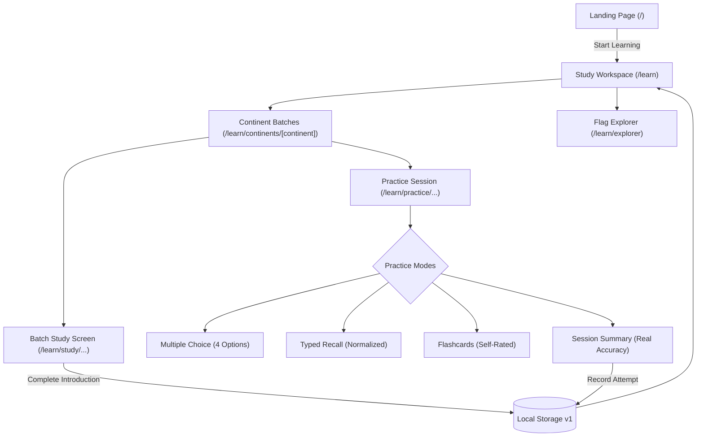

# Project Progress & Change Tracker

> **Purpose:** Maintains a chronological record of changes made after each prompt execution, tracks key specs and features, and includes visual flowcharts of the system.

---

## 1. System Visual Flowchart

> *This visual diagram renders directly in your editor without any extensions or dependencies:*

```text
┌──────────────────────────────────────────────────────────────────────────────┐
│                                 ENTRY POINT                                  │
├──────────────────────────────────────────────────────────────────────────────┤
│                         [Landing Page (/)] (Minimal Dark)                    │
│      • Wordmark & Core Mission: "Know every flag. Remember every country."   │
│      • Subtle curated flag mosaic ribbon                                     │
│      • Primary CTA: [Start Learning] ──────────────────────┐                 │
└────────────────────────────────────────────────────────────┼─────────────────┘
                                                             │
                                                             ▼
┌──────────────────────────────────────────────────────────────────────────────┐
│                       PERSONAL STUDY WORKSPACE (/learn)                      │
├──────────────────────────────────────────────────────────────────────────────┤
│  [Resume Action Card]               [Real Progress Stats]                    │
│    • Resume active / next batch       • Introduced: X / 195                  │
│    • e.g. "Africa · Batch 1"          • Completed Batches: Y                 │
│                                       • Practice Accuracy: Z%                │
│                                                            │                 │
│  [Seven-Continent Progression Grid]                        │                 │
│    • Africa (54 / 6 batches)          • North America (23 / 3 batches)       │
│    • Asia (47 / 5 batches)            • South America (12 / 2 batches)       │
│    • Europe (45 / 5 batches)          • Oceania (14 / 2 batches)             │
│    • Antarctica (0 sovereign flags — honest non-curriculum state)            │
│                              │                                               │
│                              ▼ (Select Continent)                            │
│  [/learn/continents/[continent]]                                             │
│    • Sequential batch cards (10 flags each, final batch remainder)           │
│    • Status badges: "Ready to Study", "Introduced", "Completed"              │
│    • Dual actions: [Study Batch] and [Practice Batch]                        │
└──────────────┬─────────────────────────────────────────────┬─────────────────┘
               │                                             │
               ▼                                             ▼
┌───────────────────────────────┐       ┌──────────────────────────────────────┐
│    BATCH STUDY WORKSPACE      │       │       ACTIVE PRACTICE MODES          │
│ [/learn/study/.../[batchIdx]] │       │  [/learn/practice/.../[batchIdx]]    │
├───────────────────────────────┤       ├──────────────────────────────────────┤
│ • 10-Flag Focused Cards       │       │ • Mode 1: Multiple Choice (4 choices)│
│ • FlagImage (Aspect Preserved)│       │ • Mode 2: Typed Recall (Normalized)  │
│ • Name & Capital              │       │ • Mode 3: Flashcards (Self-rated)    │
│ • Next / Prev Arrow Navigation│       │                                      │
│ • [Complete Introduction]     │       │ [Session Summary & Analytics]        │
│   ──► Marks batch introduced  │       │ • Attempted, Correct, Accuracy %     │
│   ──► Updates localStorage    │       │ • [Practice Again] [Next Batch]      │
└──────────────┬────────────────┘       └──────────────────┬───────────────────┘
               │                                           │
               ▼                                           ▼
┌──────────────────────────────────────────────────────────────────────────────┐
│                     PERSISTENCE & DOMAIN ENGINE LAYER                        │
├──────────────────────────────────────────────────────────────────────────────┤
│  • src/lib/progress.ts: Versioned localStorage schema (v1) with validation   │
│  • src/lib/answers.ts: Case/diacritic/punctuation normalizer & alias engine  │
│  • src/lib/batches.ts: Deterministic 10-flag chunker with zero duplicates    │
│  • src/lib/countries.ts: 195 sovereign state dataset loader & continent map  │
└──────────────────────────────────────────────────────────────────────────────┘
```

<details>
<summary><b>Click to expand Mermaid diagram (for Markdown Preview / GitHub)</b></summary>



</details>

---

## 2. Key Specifications & Metrics

| Category | Requirement | Current Status |
| :--- | :--- | :--- |
| **Scope** | 195 Sovereign Countries (193 UN + 2 Observers) | Verified (10/10 checks passed) |
| **Continents** | 7 Continents structured (Antarctica = 0 sovereign) | Implemented & verified |
| **Batching** | Sequential batches of 10 flags | Implemented (6 in AF, 5 in AS, 5 in EU, 3 in NA, 2 in SA, 2 in OC) |
| **Theme** | Minimalist Dark Personal Workspace | Implemented throughout app |
| **Practice Modes** | Multiple Choice, Typed Recall, Flashcards | Implemented with real session feedback |
| **Persistence** | Versioned browser localStorage (v1) | Implemented with schema validation & tests |
| **Unit Tests** | Focused automated test coverage | 22/22 unit tests passing |

---

## 3. Change History Log

### Prompt 0: Project Setup & Baseline Documentation
- Initialized `CHECKLIST.md`, reviewed `Spec.md`, set up initial documentation.

### Prompt 1: Phase 1 — Application Foundation & Architecture
- Configured Next.js with TypeScript and App Router in the root directory.
- Created `src/types/country.ts` and `src/lib/countries.ts` loading all 195 records statically.
- Implemented `FlagImage` preserving authentic flag aspect ratios with local SVG assets.
- Created automated test suites for data loading and flag verification.

### Prompt 2: Redesign + Phase 2 — Minimalist Dark Theme & Learning Experience
- **Landing Page Redesign:** Transformed `/` into a focused dark hero experience with clean headline, supporting sentence, primary CTA **Start Learning**, and subtle flag mosaic ribbon (no marketing clutter or fake statistics).
- **Dedicated Study Workspace:** Created `/learn` with real progress stats, "Continue Learning" action card, seven-continent overview, and retention review status.
- **Continent Learning Path:** Created `/learn/continents/[continent]` listing sequential batches of 10 countries with status indicators.
- **Batch Study Interface:** Created `/learn/study/[continent]/[batchIndex]` with flag presentation, metadata, keyboard arrow navigation, and introduction completion.
- **Active Practice Session:** Created `/learn/practice/[continent]/[batchIndex]` supporting Multiple Choice (4 distinct options), Typed Recall (casing/whitespace/alias normalization), and Flashcards (Again/Hard/Good/Easy), culminating in real session summaries.
- **Progress Persistence:** Implemented `src/lib/progress.ts` with versioned localStorage schema (`v1`), safe SSR/test fallback, and automated schema validation.
- **Flag Explorer:** Preserved searchable registry at `/learn/explorer`.
- **Automated Verification:** Added 13 new unit tests (22 total passing), verified TypeScript (`tsc --noEmit`), passed production build (`next build`), and ran existing dataset audit scripts.
