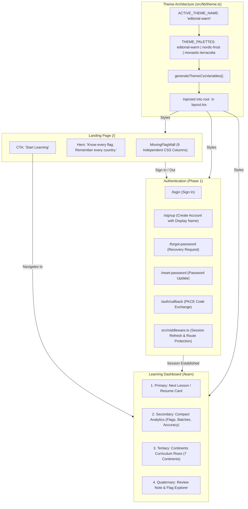

# Project Progress & Change Tracker

> **Purpose:** Maintains a chronological record of changes made after each prompt execution, tracks key specs and features, and includes visual flowcharts of the system.

---

## 1. System Visual Flowchart

> *This visual flowchart renders cleanly directly in text editors, Markdown previewers, and terminal viewers:*

```text
┌──────────────────────────────────────────────────────────────────────────────┐
│                     1. CINEMATIC LANDING PAGE (/)                            │
├──────────────────────────────────────────────────────────────────────────────┤
│  [Background Layer: MovingFlagWall.tsx]                                      │
│    • 9 Asynchronous vertical columns covering viewport                      │
│    • Real 195 local country SVGs (authentic aspect ratios)                   │
│    • GPU CSS @keyframes scrollDown (-66.6% -> -33.3% continuous 3x loop)     │
│    • Varied speeds (18s - 27s) & staggered offsets                           │
│    • Central radial vignette & top/bottom edge gradients                     │
│    • prefers-reduced-motion fallback & aria-hidden="true"                    │
│                                                                              │
│  [Header Navigation]                                                         │
│    • Brand & Scope ("195 Nations")                                           │
│    • Unauthenticated: [Sign In] (/login) | [Workspace →] (/learn)            │
│    • Authenticated: [● Display Name] | [Log Out]                             │
│                                                                              │
│  [Foreground Hero Layer]                                                     │
│    • Eyebrow: "Sovereign State Flag Memorization"                            │
│    • Headline: "Know every flag. Remember every country."                    │
│    • Subhead: "A minimalist study system across all 195 nations..."          │
│    • Primary Action: [Start Learning] ──────────────────────┐                │
└─────────────────────────────────────────────────────────────┼────────────────┘
                                                              │
               ┌──────────────────────────────────────────────┴──────────────────────────────┐
               ▼                                                                             ▼
┌─────────────────────────────────────────────┐  ┌─────────────────────────────────────────────────────────────┐
│       AUTHENTICATION SYSTEM (Phase 1)       │  │             STUDY WORKSPACE DASHBOARD (/learn)              │
├─────────────────────────────────────────────┤  ├─────────────────────────────────────────────────────────────┤
│  [Routes & Session Lifecycle]               │  │  PRIORITY 1: NEXT LESSON CARD                               │
│    • /login: Email & password sign in       │  │    • Badge: "First Lesson" / "Next Lesson" / "Resume"       │
│    • /signup: Email, pass, display name     │  │    • Continent & Batch (e.g. "Africa · Batch 1", 10 flags)  │
│    • /forgot-password: Recovery request     │  │    • Direct Action CTA: [Start First Lesson →]              │
│    • /reset-password: Pass update           │  │                                                             │
│    • /auth/callback: Code exchange handler  │  │  PRIORITY 2: COMPACT LEARNING ANALYTICS                     │
│                                             │  │    • Flags Introduced: X / 195                              │
│  [Next.js 15 App Router Architecture]       │  │    • Batches Completed: Y / 23                              │
│    • src/middleware.ts (session refresh)    │  │    • Recall Accuracy: Z% (Objective MCQ & Typed only)       │
│    • src/lib/supabase/client.ts (browser)   │  │                                                             │
│    • src/lib/supabase/server.ts (async cookies)│  PRIORITY 3: CONTINENTS CURRICULUM (Scannable rows)          │
│    • src/lib/supabase/redirect.ts (safety)  │  │    • 6 inhabited continents (Batches of 10)                 │
│    • src/lib/supabase/validation.ts (rules) │  │    • Antarctica (0 sovereign states · Honest treaty state)  │
│                                             │  │                                                             │
│  [Dual Mode Persistence]                    │  │  PRIORITY 4: SECONDARY STUDY TOOLS                          │
│    • Guest: Browser local storage (v1)      │  │    • Spaced Repetition status notice                        │
│    • Authenticated: Session-aware Header    │  │    • [Explore All 195 Flags →] (/learn/explorer)            │
└─────────────────────────────────────────────┘  └─────────────────────────────────────────────────────────────┘
```

<details>
<summary><b>Click to expand Mermaid diagram (for Markdown Preview / GitHub)</b></summary>



</details>

---

## 2. Key Specifications & Theme Tokens

| Token Category | Token Variable | `editorial-warm` (Default) | `nordic-frost` | `monastic-terracotta` |
| :--- | :--- | :--- | :--- | :--- |
| **Main Background** | `--bg-primary` | `#171814` | `#0E1116` | `#1A1615` |
| **Secondary Background** | `--bg-secondary` | `#1E1F19` | `#161B22` | `#221D1B` |
| **Elevated Surface** | `--surface-elevated` | `#25261F` | `#1F242C` | `#2B2523` |
| **Primary Text** | `--text-primary` | `#EAE6DC` | `#F0F3F6` | `#F4ECE4` |
| **Secondary Text** | `--text-secondary` | `#AAA99D` | `#A8B2C0` | `#BDB1A8` |
| **Muted Text** | `--text-muted` | `#828276` | `#6E7681` | `#8C8077` |
| **Border / Divider** | `--border-divider` | `#38392F` | `#30363D` | `#3E3430` |
| **Primary Accent** | `--accent-primary` | `#A6A77A` | `#79C0FF` | `#D47D68` |
| **Accent Contrast** | `--accent-primary-contrast` | `#171814` | `#0E1116` | `#1A1615` |
| **Secondary Accent** | `--accent-secondary` | `#C5A574` | `#D29922` | `#DCA265` |
| **Success State** | `--status-success` | `#7DA383` | `#56D364` | `#7E9F80` |
| **Error State** | `--status-error` | `#C26762` | `#F85149` | `#D6655F` |
| **Hero Vignette** | `--hero-overlay-center`| `rgba(23, 24, 20, 0.76)` | `rgba(14, 17, 22, 0.76)` | `rgba(26, 22, 21, 0.76)` |

---

## 3. Chronological Change Log

### Phase 1: Supabase Authentication Implementation
- **Dependencies Installed:**
  - `@supabase/ssr` (v0.12.7) and `@supabase/supabase-js` (v2.117.3).
- **Architecture & Client Setup:**
  - `src/lib/supabase/config.ts`: Centralized environment variable resolver for `NEXT_PUBLIC_SUPABASE_URL` and `NEXT_PUBLIC_SUPABASE_PUBLISHABLE_KEY` (with `NEXT_PUBLIC_SUPABASE_ANON_KEY` alias).
  - `src/lib/supabase/client.ts`: Singleton browser client with SSR cookie handling.
  - `src/lib/supabase/server.ts`: Next.js 15 server client with asynchronous `cookies()` support.
  - `src/lib/supabase/middleware.ts` & `src/middleware.ts`: Request lifecycle session refresher and route guard.
  - `src/lib/supabase/redirect.ts`: Open-redirect sanitization utility restricting destinations to safe internal relative paths.
  - `src/lib/supabase/validation.ts`: Form validators for email syntax, password minimums, and display name constraints.
- **Authentication Routes (`src/app/`):**
  - `/login`: Email + password authentication with setup alerts and guest access.
  - `/signup`: Registration collecting email, password, and separate display name (stored in `options.data.display_name`).
  - `/forgot-password`: Recovery request form with user-enumeration protection.
  - `/reset-password`: Password update form with recovery session verification.
  - `/auth/callback`: Next.js route handler exchanging recovery/confirmation code for cookies.
- **Header Component Update (`src/components/Header.tsx`):**
  - Unobtrusive "Sign In" link when unauthenticated.
  - User badge displaying `display_name` with green dot and "Log Out" action when authenticated.
- **Testing & Verification:**
  - Created `tests/auth.test.ts` (11 unit tests covering config validation, redirect sanitization, and form rules).
  - All 38 tests passing; `npx tsc --noEmit` 0 errors; `npm run build` static generation (11/11 routes) succeeded.

### Prompt 5: Fix and Refine the Animated Flag Background
- **Root Cause Fix for Slow Motion & Obscured Flags:**
  - Diagnosed that 50s duration across 1680px resulted in a 33px/sec imperceptible crawl, coupled with `0.5` track opacity and `0.91` dark overlay crushing visibility.
  - Increased animation speeds to 18s–27s (~90–130px/sec downward drift) with staggered offsets for clearly noticeable, fluid movement from the first second.
- **Larger Flag Sizing with Native Aspect Ratios (`MovingFlagWall.module.css`):**
  - Scaled flag target height up to `clamp(68px, 7.5vh, 92px)` with `width: auto; max-width: 100%`, allowing natural aspect ratios (1:1, 3:2, 2:1) without card border cropping or letterboxing.
  - Increased vertical spacing between consecutive flags to `clamp(1.25rem, 2vh, 1.75rem)`.
- **Distinct Horizontal Spacing & Full Viewport Coverage:**
  - Switched track to `justify-content: space-evenly` with prominent horizontal gaps (`clamp(1.5rem, 2.2vw, 2.75rem)`), eliminating narrow center clumping and dark margins.
  - Triplicated column items (`3 * N`) with `-66.6666%` to `-33.3333%` translation, mathematically guaranteeing 100% continuous coverage with zero loop resets or blank gaps on any screen size.
- **Vibrant Flag Visibility & Crisp Readability:**
  - Raised animation track opacity to `0.82` and relaxed center radial overlay to `0.76` (and `0.38` at edges).
  - Strengthened hero text drop shadows and mobile contrast for crystal-clear readability.
- **Verification:**
  - Automated tests passing (27/27); `npx tsc --noEmit` 0 errors; browser visual inspection confirmed prominent flags, distinct streams, downward motion, and mobile adaptability.

### Prompt 4: Animated Flag Landing Page, Learning Dashboard Redesign & Configurable Theme System
- **Centralized Theme System (`src/lib/theme.ts`):**
  - Built single source of truth for all semantic colors, typography, and geometry tokens.
  - Implemented 3 complete, consistent palettes (`editorial-warm`, `nordic-frost`, `monastic-terracotta`).
  - Implemented `generateThemeCssVariables()` and injected `:root` custom properties into `src/app/layout.tsx`.
  - Harmonized global CSS rules with semantic variables.
- **Continuous Asynchronous Flag Landing Page (`src/components/MovingFlagWall.tsx`, `src/app/page.tsx`):**
  - Partitioned 195 local SVGs across 9 vertical columns.
  - Created GPU-accelerated continuous downward `@keyframes scrollDown (-50% -> 0%)` animations with varied column durations (36s–58s) and offsets.
  - Added radial contrast vignette and gradient boundaries for clear hero readability.
  - Added `prefers-reduced-motion` fallback and `aria-hidden="true"` accessibility protections.
- **Learning Dashboard Hierarchy Redesign (`src/app/learn/page.tsx`, `page.module.css`):**
  - Implemented priority 1: Prominent Next Lesson card driven by dynamic `getNextLessonRecommendation()` from real progress.
  - Implemented priority 2: Compact learning analytics grid (Flags Introduced / 195, Batches Completed / 23, Recall Accuracy with honest empty state).
  - Implemented priority 3: Scannable 7-continent curriculum rows with Antarctica honestly excluded.
  - Implemented priority 4: Secondary study tools (Spaced Repetition note and Flag Explorer link).
- **Test Suite & Verification:**
  - Added `tests/theme.test.ts` verifying all tokens, CSS generation, and palette differentiation.
  - Added dynamic next lesson tests to `tests/learning-workflow.test.ts`.
  - All 27 tests passing; `npx tsc --noEmit` 0 errors; `npm run build` static generation 6/6 succeeded.
