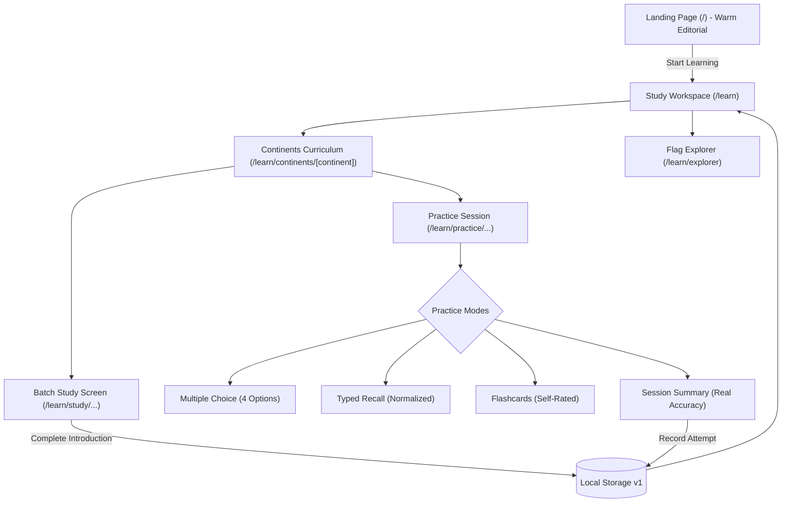

# Project Progress & Change Tracker

> **Purpose:** Maintains a chronological record of changes made after each prompt execution, tracks key specs and features, and includes visual flowcharts of the system.

---

## 1. System Visual Flowchart

> *This visual diagram renders directly in your editor without any extensions or dependencies:*

```text
┌──────────────────────────────────────────────────────────────────────────────┐
│                                 ENTRY POINT                                  │
├──────────────────────────────────────────────────────────────────────────────┤
│                [Landing Page (/)] (Warm Charcoal & Literary Serif)           │
│      • Wordmark & Mission: "Know every flag. Remember every country."        │
│      • Subtle flag vignette framed by hairline rules                         │
│      • Primary CTA: [Start Learning] (Muted Olive) ────────┐                 │
└────────────────────────────────────────────────────────────┼─────────────────┘
                                                             │
                                                             ▼
┌──────────────────────────────────────────────────────────────────────────────┐
│                    STUDY WORKSPACE DASHBOARD (/learn)                        │
├──────────────────────────────────────────────────────────────────────────────┤
│  [Current Lesson Surface]            [Inline Progress Strip]                 │
│    • Resume active / next batch        • Introduced: X / 195 Flags           │
│    • e.g. "Africa · Batch 1"           • Completed Batches: Y                │
│                                        • Recall Accuracy: Z%                 │
│                                                            │                 │
│  [Continents Curriculum (Scannable Rows)]                  │                 │
│    • Africa (54 / 6 batches)          • North America (23 / 3 batches)       │
│    • Asia (47 / 5 batches)            • South America (12 / 2 batches)       │
│    • Europe (45 / 5 batches)          • Oceania (14 / 2 batches)             │
│    • Antarctica (0 sovereign flags — honest non-curriculum state)            │
│                              │                                               │
│                              ▼ (Select Continent)                            │
│  [/learn/continents/[continent]]                                             │
│    • Sequential batch cards (10 flags each, final batch remainder)           │
│    • Subtle text tags: "Ready to Study", "Introduced", "Completed"           │
│    • Actions: [Study Batch] and [Practice Batch]                             │
└──────────────┬─────────────────────────────────────────────┬─────────────────┘
               │                                             │
               ▼                                             ▼
┌───────────────────────────────┐       ┌──────────────────────────────────────┐
│    BATCH STUDY WORKSPACE      │       │       ACTIVE PRACTICE MODES          │
│ [/learn/study/.../[batchIdx]] │       │  [/learn/practice/.../[batchIdx]]    │
├───────────────────────────────┤       ├──────────────────────────────────────┤
│ • 10-Flag Focused Cards       │       │ • Mode 1: Multiple Choice (4 choices)│
│ • FlagImage (Aspect Preserved)│       │ • Mode 2: Typed Recall (Normalized)  │
│ • Name & Capital              │       │ • Mode 3: Flashcards (Self-rated)    │
│ • Next / Prev Arrow Navigation│       │                                      │
│ • [Complete Introduction]     │       │ [Session Summary & Analytics]        │
│   ──► Marks batch introduced  │       │ • Attempted, Correct, Accuracy %     │
│   ──► Updates localStorage    │       │ • [Practice Again] [Next Batch]      │
└──────────────┬────────────────┘       └──────────────────┬───────────────────┘
               │                                           │
               ▼                                           ▼
┌──────────────────────────────────────────────────────────────────────────────┐
│                     PERSISTENCE & DOMAIN ENGINE LAYER                        │
├──────────────────────────────────────────────────────────────────────────────┤
│  • src/lib/progress.ts: Versioned localStorage schema (v1) with validation   │
│  • src/lib/answers.ts: Case/diacritic/punctuation normalizer & alias engine  │
│  • src/lib/batches.ts: Deterministic 10-flag chunker with zero duplicates    │
│  • src/lib/countries.ts: 195 sovereign state dataset loader & continent map  │
└──────────────────────────────────────────────────────────────────────────────┘
```

<details>
<summary><b>Click to expand Mermaid diagram (for Markdown Preview / GitHub)</b></summary>



</details>

---

## 2. Key Specifications & Design Tokens

| Token / Category | Value / Standard | Description |
| :--- | :--- | :--- |
| **Main Background** | `#171814` | Warm charcoal base |
| **Secondary Background** | `#1E1F19` | Soft muted charcoal |
| **Elevated Surface** | `#25261F` | Warm charcoal stone |
| **Primary Text** | `#EAE6DC` | Soft warm linen |
| **Secondary Text** | `#AAA99D` | Muted stone gray |
| **Muted Text** | `#828276` | Olive slate |
| **Dividers** | `#38392F` | Refined hairline border |
| **Primary Accent** | `#A6A77A` | Muted olive |
| **Secondary Accent**| `#C5A574` | Subdued warm amber |
| **Success State** | `#7DA383` | Muted sage green |
| **Error State** | `#C26762` | Muted terracotta |
| **Headings Font** | `Newsreader` / `Charter` / `Georgia` | Literary, editorial serif |
| **Body Font** | System sans stack | High-legibility UI sans |
| **Monospace Font** | `ui-monospace`, `Cascadia Code` | ISO codes and batch counters |

---

## 3. Change History Log

### Prompt 0: Project Setup & Baseline Documentation
- Initialized `CHECKLIST.md`, reviewed `Spec.md`, set up initial documentation.

### Prompt 1: Phase 1 — Application Foundation & Architecture
- Configured Next.js with TypeScript and App Router in the root directory.
- Created `src/types/country.ts` and `src/lib/countries.ts` loading all 195 records statically.
- Implemented `FlagImage` preserving authentic flag aspect ratios with local SVG assets.
- Created automated test suites for data loading and flag verification.

### Prompt 2: Phase 2 — Minimalist Dark Theme & Learning Experience
- Created initial dark landing page and study dashboard.
- Built continent learning paths, sequential batches, multiple choice, typed recall, flashcards, and session summaries.
- Implemented versioned browser-local persistence (`localStorage` v1).

### Prompt 3: Visual Redesign & Design-System Correction
- **Replaced Generic Palette:** Eliminated electric blue accents, bright blue borders, glowing neon elements, and artificial gradients. Introduced a warm, natural palette based on warm charcoal (`#171814`), elevated stone surfaces (`#25261F`), warm linen text (`#EAE6DC`), hairline dividers (`#38392F`), and muted olive accents (`#A6A77A`).
- **Typographic System:** Replaced oversized ultra-bold headings with literary display serif typography (`Newsreader` / `Charter` / `Georgia`), paired with crisp sans-serif body text.
- **De-carded Dashboard Layout:** Removed the 3 oversized stat cards and identical card grids. Replaced with an understated inline progress strip (`10 of 195 Flags Introduced · 1 Batch Complete · 85% Accuracy`), a quiet lesson resume surface, and clean, scannable continent rows.
- **Refined Study & Practice Screens:** Replaced cartoonish emojis with subtle typography and glyphs (`✓`, `✦`). Replaced high-contrast neon feedback with muted sage green (`#7DA383`) and terracotta (`#C26762`).
- **Verified Zero Functional Regressions:** All 22 automated tests, TypeScript check (`tsc --noEmit`), production build (`next build`), and dataset integrity scripts continue to pass with 0 errors.
